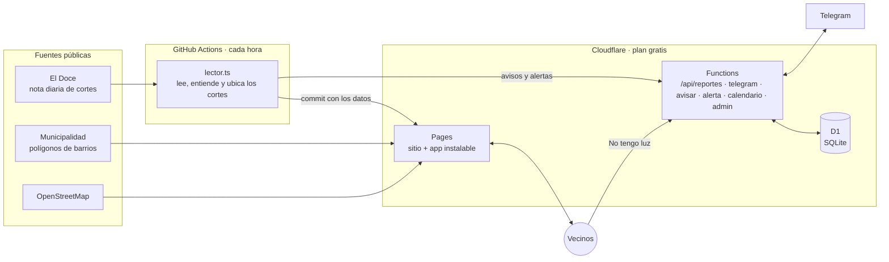

# ⚡ ¿Tengo luz?

**Mapa de los cortes de luz programados por barrio en Córdoba capital, con reportes de vecinos, avisos por Telegram y ayuda para reclamar.**

[](https://github.com/NicolasGonzalezSueyro/tengo-luz/actions/workflows/tests.yml)
[](https://github.com/NicolasGonzalezSueyro/tengo-luz/actions/workflows/actualizar.yml)


### 🌐 [tengo-luz.pages.dev](https://tengo-luz.pages.dev)

> Proyecto personal y **no oficial**: no tiene relación con EPEC.


<p align="center">
  
</p>

## Qué hace

- 🗺️ **Mapa por barrio.** Cada hora lee los cortes que anuncia EPEC y pinta los barrios afectados según el día elegido: 🟡 programado, 🟠 en curso ahora, 🟫 zona aproximada (cuando el anuncio habla de una ruta y no de barrios).
- 🔎 **Buscador con autocompletado** (no importan las tildes), **"Mi ubicación"** con GPS y una **ficha por barrio** con el próximo y el último corte.
- 🔴 **Reportes de vecinos.** Tocás "No tengo luz" y, si no hay un corte anunciado que lo explique, tu barrio se pinta de rojo con la cantidad de reportes de las últimas 3 horas.
- 📣 **Reclamo a EPEC en un toque.** Un formulario arma el mensaje con tu contrato y dirección y lo abre en el WhatsApp oficial de EPEC para que lo mandes vos. Si elegís "cables caídos o chispas", te indica llamar ya al 0800.
- 🤖 **Bot de Telegram.** `/barrio Alberdi` y te avisa cuando anuncian un corte ahí.
- 📤 **Compartir.** Cada barrio tiene su link (`?barrio=Alberdi`) y un botón para mandar el horario del corte por WhatsApp.
- 📅 **Agendar el corte** en Google Calendar o en el calendario del celu (archivo `.ics` para iPhone, Android y Outlook), con recordatorios la noche anterior y una hora antes.
- 🛠️ **Panel de admin** (`/admin`, protegido con clave): números del sitio y del bot, y borrar reportes de vecinos.
- 📲 **App instalable que anda sin conexión,** justo cuando el corte se lleva también el wifi. Modo claro y oscuro.

## Cómo funciona



1. **Leer.** Cada hora, GitHub Actions busca en el sitemap de noticias de El Doce la nota diaria con los cortes de EPEC, se queda con la sección de Córdoba capital y convierte cada renglón (`De 8 a 12:30: barrios La Favela y Villa Urquiza.`) en un dato ordenado.
2. **Ubicar.** Cada barrio del anuncio se busca en el mapa oficial de la Municipalidad, normalizando nombres ("Sud" = "Sur", sin tildes) y con una tabla de alias revisada a mano.
3. **Publicar.** Si hay cortes nuevos, el robot hace un commit con los datos y Cloudflare Pages publica el sitio actualizado. No hay ninguna compu prendida.
4. **Avisar.** El mismo robot le pasa los cortes al bot, que avisa a quienes siguen esos barrios. Si algo falla, el bot le escribe al admin.

## Tecnologías

| Parte | Con qué | Por qué |
|---|---|---|
| Página | HTML, CSS y JavaScript sin frameworks, [Leaflet](https://leafletjs.com) | Liviana, rápida en celulares viejos y sin paso de compilación |
| Lógica y scripts | TypeScript, ejecutado directo por Node.js 24 | Tipos sin compilar: Node quita los tipos al correr |
| Tests | `node:test` + chequeo de tipos con `tsc` (también en el JavaScript de la página) | ~70 tests que corren en cada push |
| Automatización | GitHub Actions (cada hora) | Gratis para repos públicos |
| Hosting y API | Cloudflare Pages + Pages Functions + D1 (SQLite) | Gratis, siempre online, sin servidores que mantener |
| App | Manifest + service worker (PWA) | Instalable y usable sin conexión |
| Avisos | Bot de Telegram con webhook | El único canal de avisos gratis (SMS y WhatsApp cobran por mensaje) |

## Decisiones de diseño

- **$0 y sin servidores.** Todo corre en planes gratuitos: no hay que pagar ni dejar nada prendido.
- **Respetar a las fuentes.** El sitio de EPEC protege sus datos con una clave privada y un firewall contra programas automáticos, así que no se lee de ahí: sacar esa clave o esquivar el firewall sería saltarse una protección puesta a propósito. Se usan notas periodísticas públicas, con un `User-Agent` que identifica al proyecto, y se respetan los `robots.txt` (por eso se descartó Cba24n, que prohíbe los lectores automáticos). El objetivo es conseguir acceso oficial de EPEC.
- **Privacidad.** El reclamo se arma en el navegador: el contrato y la dirección viajan solo dentro del link de WhatsApp y nunca pasan por un servidor. Los reportes de vecinos no guardan la IP, sino un hash SHA-256 de la IP con una clave secreta y la fecha, que cambia cada día y no permite volver a la IP. La ubicación GPS se usa solo en el navegador.
- **No fallar en silencio.** Si el robot falla, si El Doce deja de publicar, aparece un barrio desconocido o los barrios de un mismo corte quedan a más de 8 km entre sí (señal de que un nombre repetido se ubicó mal), el bot avisa al admin (como mucho una vez por día por problema). Una nota rara no frena a las demás, y un aviso que falla nunca impide guardar los cortes.
- **Accesible.** Navegable con teclado, buscador con el patrón ARIA *combobox*, textos alternativos y respeto por "reducir movimiento".
- **Seguridad en capas.**
  - **Sin inyección de código:** todo texto externo se muestra como texto, nunca como HTML; incluso los nombres de OpenStreetMap en los carteles del mapa.
  - **Lista blanca de código** ([`web/_headers`](web/_headers)): una *Content-Security-Policy* hace que el navegador solo ejecute código del propio sitio y de Leaflet (verificado con SRI), y ninguna otra página puede mostrar el sitio adentro de un marco.
  - **API pública acotada:** solo acepta barrios que existen, limita por persona (con IPv6, por bloque de la casa) y rechaza pedidos grandes.
  - **Robot con permisos mínimos:** las herramientas de GitHub Actions están fijadas por *commit* y Dependabot avisa de actualizaciones de seguridad.
  - **Sin terceros innecesarios:** la tipografía se sirve desde el propio sitio, así que Google no ve a los visitantes.

## Más detalles

<details>
<summary><b>Barrios, zonas aproximadas y alias</b></summary>

El mapa de barrios ([`data/barrios.geojson`](data/barrios.geojson)) se arma con `npm run barrios`:

- **485 polígonos oficiales** de la capa de barrios de la Municipalidad de Córdoba.
- **~320 puntos** de OpenStreetMap para lugares que la Municipalidad no tiene (asentamientos, loteos nuevos). De esos se sabe dónde quedan, no su forma.
- Los nombres municipales vienen en mayúsculas y sin tildes; si OSM tiene el mismo barrio, se usa su nombre ("Argüello").

**Zonas aproximadas.** Algunos anuncios no nombran barrios sino una ruta ("zona rural sobre Ruta Nacional 9 hacia el norte"). Para esos, [`data/zonas.geojson`](data/zonas.geojson) tiene un corredor de unos 450 m a cada lado del tramo de la ruta, armado con el trazado de OpenStreetMap (`npm run zonas`). Es una referencia visual, no el límite real del corte, que EPEC no publica.

**Alias.** [`data/alias-barrios.json`](data/alias-barrios.json) dice "cuando la nota dice X, en el mapa es Y". Solo se agregan con evidencia: ubicando el lugar en un mapa y comprobando que cae dentro del polígono. Un alias en `null` marca un nombre que no se debe ubicar solo (por ejemplo, "Loteo Santa Mónica", que EPEC lista con capital pero está en Calamuchita).
</details>

<details>
<summary><b>Reportes de vecinos (API y base de datos)</b></summary>

- [`functions/api/reportes.ts`](functions/api/reportes.ts) es una Cloudflare Pages Function: `GET /api/reportes` devuelve cuántos reportes tiene cada barrio en las últimas 3 horas y `POST` suma uno.
- Se guardan en Cloudflare D1. Las tablas están en [`src/esquema.sql`](src/esquema.sql).
- La lógica está en [`src/reportes.ts`](src/reportes.ts), con tests sobre un SQLite en memoria ([`src/base-local.ts`](src/base-local.ts)), el mismo que usa `npm run dev`.
- Límites contra abuso: un reporte por barrio cada 3 horas y hasta 5 barrios por hora por persona. Los reportes se borran al día siguiente.
</details>

<details>
<summary><b>Bot de Telegram y alertas</b></summary>

- [`functions/api/telegram.ts`](functions/api/telegram.ts) recibe los mensajes (webhook, validado con un encabezado secreto) y contesta en la misma respuesta.
- [`functions/api/avisar.ts`](functions/api/avisar.ts) recibe los cortes de hoy en adelante desde GitHub Actions y avisa a cada suscripto una sola vez por corte.
- [`functions/api/alerta.ts`](functions/api/alerta.ts) le escribe al admin cuando algo anda mal.
- La lógica (comandos, a quién avisar) está en [`src/bot.ts`](src/bot.ts), con tests. Comandos de admin: `/estado`, `/reportes`, `/limpiar [barrio]`.

**¿Y otra fuente de respaldo?** Se evaluó: La Voz dejó de publicar la lista diaria en marzo de 2026, Hoy Día la publica de forma irregular y Cba24n prohíbe los lectores automáticos. Hoy El Doce es el único medio que la publica todos los días.
</details>

<details>
<summary><b>Calendario y panel de admin</b></summary>

- [`web/calendario.js`](web/calendario.js) arma el evento de cada corte: un link de Google Calendar y un archivo `.ics` (con horarios en UTC, textos escapados, renglones de hasta 75 bytes y dos recordatorios), con tests. [`functions/api/calendario.ts`](functions/api/calendario.ts) entrega el `.ics` desde una dirección real, porque así el iPhone abre directo "Agregar al calendario", y solo para cortes que existen en los datos.
- [`web/admin.html`](web/admin.html) es el panel de admin. Usa [`functions/api/admin.ts`](functions/api/admin.ts), que pide la clave `ADMIN_CLAVE` configurada en Cloudflare y la compara sin dar pistas por el tiempo de respuesta. El panel y los comandos del bot comparten la misma lógica ([`src/admin.ts`](src/admin.ts)).
</details>

<details>
<summary><b>App instalable y sin conexión</b></summary>

[`web/sw.js`](web/sw.js) es un service worker que guarda una copia de la página y de los datos. Siempre intenta traer lo más nuevo, y si no hay red o tarda más de 4 segundos, usa la copia. Los reportes de vecinos siempre se piden en vivo. El menú tiene "Instalar la app": en Android abre el instalador y en iPhone explica cómo hacerlo desde Safari.
</details>

## Estructura

```
web/              la página: HTML, CSS, JavaScript, service worker e íconos
functions/api/    funciones de Cloudflare: reportes, bot, avisos y alertas
src/              lector de cortes, ubicación de barrios, lógica del bot y scripts
data/             historial de cortes, barrios y zonas (GeoJSON), alias
docs/             capturas para este README
.github/          GitHub Actions: tests en cada push y actualización cada hora
```

## Correrlo en tu compu

Requiere Node.js 24 o más nuevo.

```bash
npm install
npm run dev        # abre la página en http://localhost:4321 (con una base de prueba en memoria)
npm test           # corre los tests
npm run typecheck  # revisa los tipos de todo el proyecto
npm run lector     # actualiza data/mantenimientos.json con las notas nuevas
npm run build      # arma la carpeta dist/ que se publica
npm run barrios    # vuelve a descargar los límites de barrios (casi nunca hace falta)
npm run zonas      # vuelve a armar las zonas aproximadas sobre rutas
npm run bot        # configura el bot de Telegram (lee el token de .env, ver .env.example)
```

## Qué aprendí

- **Linux y la terminal**, con Ubuntu en WSL: desde cero.
- **Automatizar sin servidores:** GitHub Actions como "cron" gratuito que lee, testea y publica solo.
- **Leer datos del mundo real:** las notas cambian de formato cada día, así que el lector trabaja renglón por renglón, avisa lo que no entiende y nunca inventa datos.
- **Datos geográficos:** GeoJSON, polígonos, saber en qué barrio cae un punto (*ray casting*) y armar zonas a partir de rutas.
- **Backend serverless:** funciones de Cloudflare y una base SQLite (D1), probadas con tests contra un SQLite local.
- **Privacidad por diseño:** guardar lo mínimo, hashear con una clave secreta y dejar los datos sensibles en el navegador.
- **PWA:** manifest, service worker y estrategias de caché para usar la app sin conexión.
- **Bots y webhooks** con Telegram, incluyendo validar que los pedidos sean legítimos.
- **Monitoreo:** que el sistema avise cuando algo falla en vez de romperse en silencio.
- **Ética con los datos:** respetar `robots.txt` y las protecciones de los sitios, y pedir acceso oficial en vez de esquivarlas.

## Próximos pasos

- [ ] Acceso oficial a los datos de cortes de EPEC.
- [ ] Avisos por Telegram cuando varios vecinos reportan que no tienen luz en tu barrio.
- [ ] Estadísticas: qué barrios tienen más cortes y en qué horarios.

## Fuentes y licencia

- **Cortes:** notas públicas de [El Doce](https://eldoce.tv), que replican los anuncios de EPEC. Cada corte guarda el link a la nota de origen.
- **Barrios:** capa pública de barrios de la [Municipalidad de Córdoba](https://cordoba.maps.arcgis.com/home/item.html?id=60f4e6cbb6ee47e88679a76a5b763326), complementada con datos © colaboradores de [OpenStreetMap](https://www.openstreetmap.org/copyright) (ODbL).
- **Íconos:** estilo [Lucide](https://lucide.dev) (ISC).
- **Tipografía:** [Outfit](https://github.com/Outfitio/Outfit-Fonts) (SIL Open Font License, en [`web/fuentes/OFL.txt`](web/fuentes/OFL.txt)).

Código bajo licencia [MIT](LICENSE). Hecho por Nicolás González Sueyro en Córdoba.
