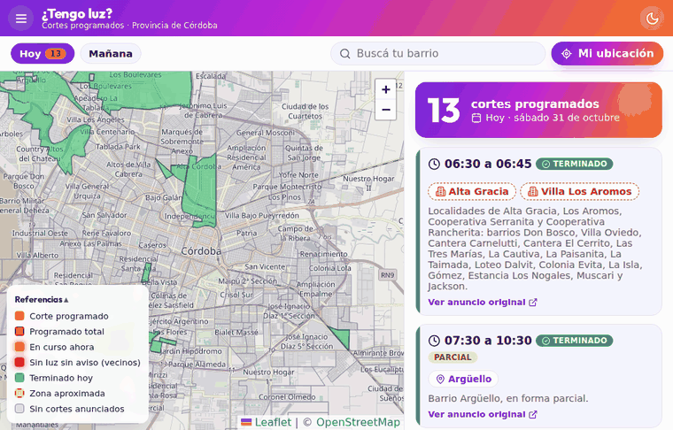
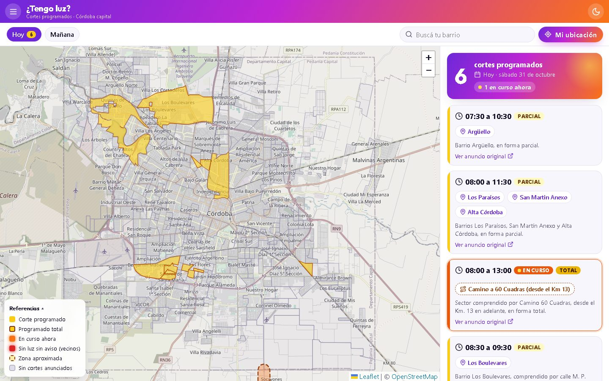
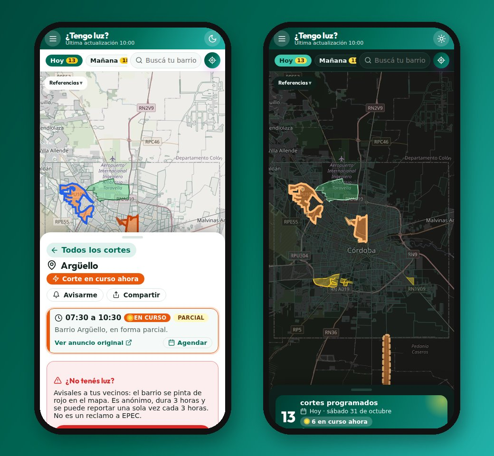
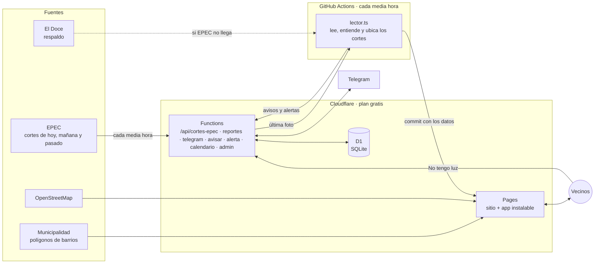

# ⚡ ¿Tengo luz?

**Mapa de los cortes de luz programados en Córdoba: por barrio en capital y por localidad en toda la provincia, con reportes de vecinos, avisos por Telegram y ayuda para reclamar.**

[](https://github.com/NicolasGonzalezSueyro/tengo-luz/actions/workflows/tests.yml)
[](https://github.com/NicolasGonzalezSueyro/tengo-luz/actions/workflows/actualizar.yml)


### 🌐 [tengo-luz.pages.dev](https://tengo-luz.pages.dev)

> Proyecto personal y **no oficial**: no tiene relación con EPEC.





<p align="center">
  
</p>

## Qué hace

- 🗺️ **Mapa por barrio.** Cada media hora lee los cortes que anuncia EPEC y pinta los barrios afectados según el día elegido: 🟡 programado, 🟠 en curso ahora, 🟢 terminado hoy, 🟫 zona aproximada (cuando el anuncio habla de una ruta, o de una localidad sin barrios que se puedan ubicar). La página se actualiza sola cada 30 segundos (y al volver a la app), sin recargar, y muestra la hora de la última actualización.
- 🏘️ **Toda la provincia.** Además de capital, cualquier localidad que nombre el anuncio: Villa María, Río Cuarto, San Francisco, Bell Ville, Cosquín, Deán Funes y más de 100 en total. Cuando aparece un pueblo nuevo, el robot lo ubica solo con OpenStreetMap. Si el corte nombra barrios o parajes, se pintan esos; si es en todo el pueblo, solo el casco urbano (no el campo del ejido).
- 🔎 **Buscador con autocompletado** (no importan las tildes), **"Mi ubicación"** con GPS y una **ficha por barrio** con el próximo y el último corte.
- ⚠️ **Fallas confirmadas por EPEC.** Los cortes no programados que EPEC confirma en X o Facebook se marcan en bordó, con el texto de la publicación. Un extractor aparte lee las publicaciones de @EpecOficial y las manda al sitio: las claras se publican solas y las raras (sin lugares reconocidos, o que mezclan barrios de capital con localidades del interior) esperan que el admin las confirme en el bot. También se pueden cargar a mano compartiéndole al bot los links (hasta 10 en un mensaje) o el texto. Cuando EPEC publica que volvió el servicio, se sacan del mapa solo los lugares que nombra (el resto de la falla sigue); si nadie lo confirma, la falla se va sola a las 6 horas (o con `/fin_falla`). Se le pueden sumar lugares con `/agregar`, avisa a quienes siguen esos lugares, y si EPEC nombra calles, el robot achica la falla a ese sector.
- 🔴 **Reportes de vecinos.** Tocás "No tengo luz" y, si no hay un corte anunciado que lo explique, tu barrio se pinta de rojo con la cantidad de reportes de las últimas 3 horas. Solo se puede reportar que **no** hay luz (nadie puede "apagar" un corte), y cada conexión puede reportar una sola vez cada 3 horas. Cuando 3 vecinos reportan el mismo barrio, les llega un aviso a quienes lo siguen (aclarando que lo reportan vecinos, no EPEC; como mucho uno por día).
- 📣 **Reclamo a EPEC en un toque.** Un formulario arma el mensaje con tu contrato y dirección y lo abre en el WhatsApp oficial de EPEC para que lo mandes vos. Si elegís "cables caídos o chispas", te indica llamar ya al 0800.
- 🤖 **Bot de Telegram.** `/barrio Alberdi` y te avisa cuando anuncian un corte ahí.
- 🔔 **Notificaciones en el celular, sin Telegram.** "Avisarme" en la ficha de un barrio y llega una notificación cuando anuncian un corte (en iPhone, con la app instalada).
- 📤 **Compartir.** Cada barrio tiene su link (`?barrio=Alberdi`) y un botón para mandar el horario del corte por WhatsApp.
- 📅 **Agendar el corte** en Google Calendar o en el calendario del celu (archivo `.ics` para iPhone, Android y Outlook), con recordatorios la noche anterior y una hora antes.
- 📊 **Estadísticas** (`/estadisticas.html`), separadas en **trabajos programados** y **cortes repentinos** (fallas de los últimos 90 días): qué barrios y localidades tienen más cortes, cuánto duran, qué días y a qué hora empiezan, con gráficos de barras hechos en HTML (sin librerías).
- 🛠️ **Panel de admin** (`/admin`, protegido con clave): números del sitio y del bot, y borrar reportes de vecinos.
- 📲 **App instalable que anda sin conexión,** justo cuando el corte se lleva también el wifi. Modo claro y oscuro.

## Cómo funciona



1. **Leer.** Un servicio externo manda cada media hora los cortes que publica EPEC (hoy, mañana y pasado) a `/api/cortes-epec`, que guarda la última foto en D1. El robot de GitHub Actions la lee y pasa cada corte a un dato ordenado; un corte que EPEC deja de publicar se da de baja. Si EPEC no manda nada en 3 horas, el robot vuelve a la nota diaria de El Doce (y le avisa al admin).
2. **Ubicar.** Cada barrio del anuncio se busca en el mapa oficial de la Municipalidad, normalizando nombres ("Sud" = "Sur", sin tildes) y con una tabla de alias revisada a mano.
3. **Publicar.** Si hay cortes nuevos, el robot hace un commit con los datos y Cloudflare Pages publica el sitio actualizado. No hay ninguna compu prendida.
4. **Avisar.** El mismo robot le pasa los cortes al bot, que avisa a quienes siguen esos barrios. Si algo falla, el bot le escribe al admin.

## Tecnologías

| Parte | Con qué | Por qué |
|---|---|---|
| Página | HTML, CSS y JavaScript sin frameworks, [Leaflet](https://leafletjs.com) | Liviana, rápida en celulares viejos y sin paso de compilación |
| Lógica y scripts | TypeScript, ejecutado directo por Node.js 24 | Tipos sin compilar: Node quita los tipos al correr |
| Tests | `node:test` + chequeo de tipos con `tsc`, y [Playwright](https://playwright.dev) de punta a punta | ~130 tests unitarios y recorridos reales en una compu y un celular simulados, en cada push |
| Automatización | GitHub Actions (cada media hora) | Gratis para repos públicos |
| Hosting y API | Cloudflare Pages + Pages Functions + D1 (SQLite) | Gratis, siempre online, sin servidores que mantener |
| App | Manifest + service worker (PWA) | Instalable y usable sin conexión |
| Avisos | Bot de Telegram con webhook, y notificaciones Web Push | Los dos son gratis (SMS y WhatsApp cobran por mensaje) |

## Decisiones de diseño

- **$0 y sin servidores.** Todo corre en planes gratuitos: no hay que pagar ni dejar nada prendido.
- **Privacidad.** El reclamo se arma en el navegador: el contrato y la dirección viajan solo dentro del link de WhatsApp y nunca pasan por un servidor. Los reportes de vecinos no guardan la IP, sino un hash SHA-256 de la IP con una clave secreta y la fecha, que cambia cada día y no permite volver a la IP. La ubicación GPS se usa solo en el navegador.
- **No fallar en silencio.** Si el robot falla, si El Doce deja de publicar, aparece un barrio desconocido o los barrios de un mismo corte quedan a más de 8 km entre sí (señal de que un nombre repetido se ubicó mal), el bot avisa al admin (como mucho una vez por día por problema). Una nota rara no frena a las demás, y un aviso que falla nunca impide guardar los cortes.
- **Accesible.** Navegable con teclado, buscador con el patrón ARIA *combobox*, textos alternativos y respeto por "reducir movimiento".
- **Seguridad en capas.**
  - **Sin inyección de código:** todo texto externo se muestra como texto, nunca como HTML; incluso los nombres de OpenStreetMap en los carteles del mapa.
  - **Lista blanca de código** ([`web/_headers`](web/_headers)): una *Content-Security-Policy* hace que el navegador solo ejecute código del propio sitio y de Leaflet (verificado con SRI), y ninguna otra página puede mostrar el sitio adentro de un marco.
  - **API pública acotada:** solo acepta barrios que existen, permite un reporte por conexión cada 3 horas (con IPv6, por bloque de la casa) y rechaza pedidos grandes.
  - **Robot con permisos mínimos:** las herramientas de GitHub Actions están fijadas por *commit* y Dependabot avisa de actualizaciones de seguridad.
  - **Sin terceros innecesarios:** la tipografía se sirve desde el propio sitio, así que Google no ve a los visitantes.

## Más detalles

<details>
<summary><b>Barrios, zonas aproximadas y alias</b></summary>

El mapa de barrios ([`data/barrios.geojson`](data/barrios.geojson)) se arma con `npm run barrios`:

- **485 polígonos oficiales** de la capa de barrios de la Municipalidad de Córdoba, simplificados con el algoritmo de Douglas-Peucker ([`src/simplificar.ts`](src/simplificar.ts)): se sacan los puntos que mueven el contorno menos de 4 m. El archivo pasó de 1,3 MB a 310 KB (57 KB comprimido) y a la vista queda igual.
- **~320 puntos** de OpenStreetMap para lugares que la Municipalidad no tiene (asentamientos, loteos nuevos). De esos se sabe dónde quedan, no su forma.
- Los nombres municipales vienen en mayúsculas y sin tildes; si OSM tiene el mismo barrio, se usa su nombre ("Argüello").

**Zonas aproximadas.** [`data/zonas.geojson`](data/zonas.geojson) (`npm run zonas`) tiene dos tipos, armados con datos de OpenStreetMap. Son una referencia visual, no el límite real del corte, que EPEC no publica.

- **Rutas:** algunos anuncios de capital no nombran barrios sino una ruta ("zona rural sobre Ruta Nacional 9 hacia el norte"). Para esos hay un corredor de unos 450 m a cada lado del tramo de la ruta.
- **Sector exacto** ([`src/sectores.ts`](src/sectores.ts)): cuando el anuncio nombra calles ("sector comprendido por calles Alberdi, Caseros, Alvear…"), lugares ("Teatro del Lago, Terminal de Ómnibus") o barrios, se buscan en OpenStreetMap dentro de la zona, se calculan las esquinas donde se cruzan esas calles (también las "T") y se dibuja el área que encierran. Se descartan los puntos sueltos (calles con el mismo nombre en otra punta) y lo que cae fuera de la localidad. Los nombres repetidos son comunes (en Gran Córdoba hay 42 cosas llamadas "Los Aromos": calles en 7 localidades, una comuna, una rotonda…), así que cada nombre se busca solo dentro de la localidad del corte, un "barrio X" nunca se confunde con la calle X, y la localidad se toma del título de la sección o de la lista "Localidades de …:", no de cualquier parte del texto (un "Camino a Alta Gracia" no es un corte en Alta Gracia). Si no se puede armar algo confiable (por ejemplo, el anuncio nombra 20 barrios y se encuentran 3), se marca la zona entera: mejor de más que un área chica engañosa. Cada sector se busca una sola vez y queda guardado en [`data/sectores.json`](data/sectores.json).
- **Localidades de la provincia** ([`src/localidades.ts`](src/localidades.ts)): fuera de capital no hay un mapa oficial de barrios, y EPEC suele describir los cortes por calles ("sector comprendido por calles Alberdi, Caseros…"). Por eso se marca el límite de la localidad entera (o un círculo, si OpenStreetMap no tiene su límite). Las de Gran Córdoba están cargadas a mano; el resto se busca en Nominatim la primera vez que aparece y queda guardado ([`data/localidades-buscadas.json`](data/localidades-buscadas.json)). Los pueblos que OpenStreetMap no tiene se cargan a mano en [`data/localidades-manuales.json`](data/localidades-manuales.json) con el nombre de la nota y sus coordenadas (`"Mula Muerta": "-30.0123, -64.4567"`), y se marcan con un círculo; el robot avisa si una coordenada cae fuera de la provincia. Los nombres salen del título de la sección o de la lista "Localidades de …:", y si la lista contradice al título (pasa: un renglón de Colazo bajo el título "Saldán"), manda la lista. Se descartan barrios y calles con el mismo nombre ("San Francisco" también es un barrio de capital), y los nombres repetidos se resuelven por cercanía (hay tres "San Antonio" en la provincia): se elige el que queda a menos de 40 km de las otras localidades del corte, y si ninguno está tan cerca, no se marca. Nunca se buscan barrios de capital en esos cortes: un "barrio Don Bosco" de Alta Gracia no pinta uno de capital. Las ubicaciones dudosas se compararon a mano con un mapa.
- **Barrios del interior** ([`src/barrios-interior.ts`](src/barrios-interior.ts), `npm run barrios-interior`): para cada localidad se bajan de OpenStreetMap sus barrios y las zonas con casas. Si el municipio publica su **capa oficial de barrios** en [Mapas Córdoba](https://www.mapascordoba.gob.ar) (IDECOR, Provincia de Córdoba; hoy 15: Villa María, Río Cuarto, Villa Allende, Unquillo, Cosquín, Jesús María, La Falda, Salsipuedes, Colonia Caroya, Anisacate y otros), esa manda: un nombre de OSM que cae adentro de un barrio oficial ("Rivadavia" en "Bernardino Rivadavia") toma ese contorno, y "Centro" toma la unión de Centro Norte, Sur, Este y Oeste. El **casco urbano** es la unión de las zonas residenciales, los barrios y una franja de 45 m alrededor de las calles residenciales, recortada al ejido: eso se pinta cuando el corte es en todo el pueblo. Los barrios y parajes que nombra EPEC y OSM no tiene como área se buscan en Nominatim (primero dentro del pueblo, después como paraje hasta 25 km alrededor) y reciben un **contorno aproximado**: la zona más cercana a ese punto que a cualquier otro barrio (Voronoi), de 150 a 600 m de radio, sin pisar los barrios conocidos. En el mapa se ven con borde punteado. Los nombres se comparan con tolerancia ([`src/nombres.ts`](src/nombres.ts): "Covicco" = "Covico", "Minetti III" = "Minetti", "Santa Isabel 2" = "Santa Isabel 2ª Sección"), pero siempre dentro de la localidad del corte. [`src/barrios-capital.ts`](src/barrios-capital.ts) hace lo mismo con los lugares de capital que no están en el mapa municipal. Google Maps se usó solo para comparar a ojo, nunca para copiar contornos.

**Divisiones de capital.** Adentro de algunos barrios municipales hay countries y loteos que EPEC nombra por separado (en Valle Escondido: Los Árboles, Las Cigarras, El Rocío, Los Cielos, El Balcón…). [`src/barrios-capital.ts`](src/barrios-capital.ts) les da el contorno que tienen en OpenStreetMap o, si no tienen, uno aproximado de hasta 300 m que no se sale del barrio que los contiene. En el mapa se ven como líneas finas al acercarse (zoom 14 o más). Se compararon con Google Maps, que de los countries muestra solo un pin: se revisó que el pin caiga adentro del contorno.

**Corregir contornos a mano.** `npm run editor` abre en la compu ([http://localhost:4400](http://localhost:4400)) un editor ([`herramientas/editor.html`](herramientas/editor.html), con [Leaflet-Geoman](https://geoman.io)): se busca o se toca un lugar, se arrastran los puntos del borde (o se dibuja de cero, con calles o satélite de fondo y un link a la misma zona en Google Maps para comparar) y se guarda. También sirve para agregar un barrio o paraje que falta. Lo guardado queda en [`data/contornos-manuales.geojson`](data/contornos-manuales.geojson) junto con el contorno original (para "Volver al original"), y todos los scripts que regeneran los mapas lo vuelven a aplicar ([`src/contornos.ts`](src/contornos.ts)), así una corrección no se pierde. El editor solo escucha en la propia compu. De fondo se puede elegir calles (OpenStreetMap), satélite (Esri) o el mapa del IGN, y prender guías de la Provincia (Mapas Córdoba): manzanas, parcelas, radios urbanos, loteos aprobados de capital y barrios oficiales de los municipios.

**Lugares que faltan.** `npm run faltantes` (lo corre solo el editor) lista en `data/lugares-faltantes.json` los barrios y parajes que nombra EPEC y ninguna fuente tiene (ni OSM, ni la Provincia, ni Nominatim, ni [GeoNames](https://www.geonames.org)), ordenados por cuántas veces aparecen. El editor los muestra: se toca uno, va a su localidad con el nombre ya cargado, y se dibuja.

**Alias.** [`data/alias-barrios.json`](data/alias-barrios.json) dice "cuando la nota dice X, en el mapa es Y". Solo se agregan con evidencia: ubicando el lugar en un mapa y comprobando que cae dentro del polígono. Un alias en `null` marca un nombre que no se debe ubicar solo (por ejemplo, "Loteo Santa Mónica", que EPEC lista con capital pero está en Calamuchita).

**Alias del interior.** [`data/alias-interior.json`](data/alias-interior.json) hace lo mismo para los barrios del interior, con la localidad entre paréntesis: `"2 Hermanos (San Francisco)": "Dos Hermanos (San Francisco)"`.
</details>

<details>
<summary><b>Reportes de vecinos (API y base de datos)</b></summary>

- [`functions/api/reportes.ts`](functions/api/reportes.ts) es una Cloudflare Pages Function: `GET /api/reportes` devuelve cuántos reportes tiene cada barrio en las últimas 3 horas y `POST` suma uno.
- Se guardan en Cloudflare D1. Las tablas están en [`src/esquema.sql`](src/esquema.sql).
- La lógica está en [`src/reportes.ts`](src/reportes.ts), con tests sobre un SQLite en memoria ([`src/base-local.ts`](src/base-local.ts)), el mismo que usa `npm run dev`.
- Límites contra abuso: cada conexión reporta una sola vez cada 3 horas, en cualquier barrio (una persona está en un solo lugar). No se pide nombre ni datos personales: no se podrían verificar y obligarían a guardar información sensible. Los reportes se borran al día siguiente.
- Contra: con datos móviles, varias personas pueden salir a internet con la misma IP (CGNAT). Si dos vecinos de la misma compañía reportan a la vez, puede contar uno solo; el barrio igual se pinta de rojo.
</details>

<details>
<summary><b>Bot de Telegram y alertas</b></summary>

- [`functions/api/telegram.ts`](functions/api/telegram.ts) recibe los mensajes (webhook, validado con un encabezado secreto) y contesta en la misma respuesta.
- [`functions/api/avisar.ts`](functions/api/avisar.ts) recibe los cortes de hoy en adelante desde GitHub Actions y avisa a cada suscripto una sola vez por corte.
- [`functions/api/alerta.ts`](functions/api/alerta.ts) le escribe al admin cuando algo anda mal.
- La lógica (comandos, a quién avisar) está en [`src/bot.ts`](src/bot.ts), con tests. Comandos de admin: `/estado`, `/reportes`, `/limpiar [barrio]`, y los de fallas.
- **Fallas confirmadas** ([`src/fallas.ts`](src/fallas.ts)): leer X o Facebook de forma automática no es posible gratis y respetando sus reglas (la API de X se paga por uso desde 2026, y Facebook pide revisión de la app y verificar una empresa), así que la carga es semiautomática. El admin comparte el link de la publicación con el bot, que lee el texto con el servicio oficial de inserción de X (oEmbed, público y sin clave) o usa el texto pegado, reconoce los barrios y localidades del mapa (primero los nombres más largos, para que "Alto Alberdi" no cuente como "Alberdi") y lo muestra para revisar. Nada se publica sin `/confirmar`, y `/corregir Alberdi, Centro` arregla los lugares. La página las trae de [`functions/api/fallas.ts`](functions/api/fallas.ts).
- **Entrada para un extractor externo:** `POST /api/fallas` con `Authorization: Bearer <FALLAS_CLAVE>` y `{ "id", "url", "texto", "publicado"? }` (o `{ "publicaciones": [ … ] }`, hasta 20). Se clasifica cada publicación (falla, "volvió el servicio" u otra cosa), no se repite un link ya recibido, las fallas claras se publican solas (con aviso a los suscriptos y al admin) y las raras quedan esperando `/confirmar`. Responde el estado de cada una: `publicada`, `pendiente`, `sin_lugares`, `repetida`, `restablecida` o `ignorada`. Un "volvió el servicio" saca de las fallas activas solo los lugares que nombra, y la falla termina cuando no le queda ninguno.
- **Sector de las fallas** ([`src/sectores-fallas.ts`](src/sectores-fallas.ts)): la falla aparece al instante por barrio; después, el robot de GitHub pide las que no tienen sector (`GET /api/fallas?sin-sector`), calcula con OpenStreetMap el área de las calles que nombra EPEC y la guarda (`POST` con `accion: "sectores"`). Se hace en GitHub y no en Cloudflare porque consultar OpenStreetMap lleva más tiempo de CPU del que da el plan gratis.

**¿Y otra fuente de respaldo?** Se evaluó: La Voz dejó de publicar la lista diaria en marzo de 2026, Hoy Día la publica de forma irregular y Cba24n prohíbe los lectores automáticos. Hoy El Doce es el único medio que la publica todos los días.
</details>

<details>
<summary><b>Calendario, panel de admin y estadísticas</b></summary>

- [`web/calendario.js`](web/calendario.js) arma el evento de cada corte: un link de Google Calendar y un archivo `.ics` (con horarios en UTC, textos escapados, renglones de hasta 75 bytes y dos recordatorios), con tests. [`functions/api/calendario.ts`](functions/api/calendario.ts) entrega el `.ics` desde una dirección real, porque así el iPhone abre directo "Agregar al calendario", y solo para cortes que existen en los datos.
- [`web/admin.html`](web/admin.html) es el panel de admin. Usa [`functions/api/admin.ts`](functions/api/admin.ts), que pide la clave `ADMIN_CLAVE` configurada en Cloudflare y la compara sin dar pistas por el tiempo de respuesta. El panel y los comandos del bot comparten la misma lógica ([`src/admin.ts`](src/admin.ts)).
- [`web/estadisticas.html`](web/estadisticas.html) calcula todo en el navegador a partir del historial (`data/mantenimientos.json`), sin base de datos: la cuenta está en [`web/estadisticas.js`](web/estadisticas.js), con tests. Cada horario anunciado cuenta como un corte, la duración típica es la mediana (no la deja torcida un corte larguísimo) y los cortes que pasan la medianoche se miden bien. Los cortes repentinos salen de  (90 días, con caché de 10 minutos).
</details>

<details>
<summary><b>Notificaciones push</b></summary>

- El navegador da una dirección anónima y unas claves; se guardan en D1 junto con el barrio ([`functions/api/push.ts`](functions/api/push.ts)). Solo se aceptan direcciones de los servicios de push de Google, Apple, Mozilla y Microsoft.
- Cada media hora, [`functions/api/avisar.ts`](functions/api/avisar.ts) manda a cada suscripto un aviso por corte, igual que el bot. Si el servicio responde que la suscripción ya no existe, se borra.
- [`src/push.ts`](src/push.ts) implementa los dos estándares sin librerías, con WebCrypto: la firma **VAPID** (RFC 8292, un JWT ES256) y el **cifrado** del mensaje (RFC 8291, ECDH + HKDF + AES-128-GCM). Un test compara el resultado byte por byte con el ejemplo oficial del RFC.
- La clave privada es el secreto `PUSH_CLAVE` de Cloudflare (`npm run claves-push` la genera). El panel de admin tiene un botón para mandar una notificación de prueba.
</details>

<details>
<summary><b>Tests</b></summary>

- **Unitarios** (`npm test`): la lógica de cada parte, incluidas las funciones de Cloudflare contra un SQLite en memoria.
- **De punta a punta** (`npm run e2e`, [`e2e/`](e2e/)): Playwright abre la página en Chromium, como compu y como celular, y recorre lo que haría una persona: buscar con autocompletado, abrir un link compartido, reportar (y comprobar el límite por conexión), armar el reclamo de WhatsApp, entrar al panel de admin, abrir las estadísticas desde el menú, revisar que nada se salga de la pantalla en el celular y que estén las cabeceras de seguridad. Corre en GitHub Actions en cada push; si falla, queda un informe con capturas.
</details>

<details>
<summary><b>App instalable y sin conexión</b></summary>

[`web/sw.js`](web/sw.js) es un service worker que guarda una copia de la página y de los datos. Siempre intenta traer lo más nuevo, y si no hay red o tarda más de 4 segundos, usa la copia. Los reportes de vecinos siempre se piden en vivo. El menú tiene "Instalar la app": en Android abre el instalador y en iPhone explica cómo hacerlo desde Safari.
</details>

## Estructura

```
web/              la página: HTML, CSS, JavaScript, service worker e íconos
functions/api/    funciones de Cloudflare: reportes, bot, avisos y alertas
src/              lector de cortes, ubicación de barrios, lógica del bot y scripts
data/             historial de cortes, barrios y zonas (GeoJSON), alias
docs/             capturas para este README
.github/          GitHub Actions: tests en cada push y actualización cada media hora
```

## Correrlo en tu compu

Requiere Node.js 24 o más nuevo.

```bash
npm install
npm run dev        # abre la página en http://localhost:4321 (con una base de prueba en memoria)
npm test           # corre los tests
npm run typecheck  # revisa los tipos de todo el proyecto
npm run lector     # actualiza data/mantenimientos.json con las notas nuevas
npm run build      # arma la carpeta dist/ que se publica
npm run barrios    # vuelve a descargar los límites de barrios (casi nunca hace falta)
npm run zonas      # vuelve a armar las zonas aproximadas sobre rutas
npm run bot        # configura el bot de Telegram (lee el token de .env, ver .env.example)
npm run e2e        # tests de punta a punta (la primera vez: npx playwright install chromium)
npm run claves-push   # genera la clave de las notificaciones (para el secreto PUSH_CLAVE)
npm run simplificar   # vuelve a simplificar los contornos del mapa
```

## Qué aprendí

- **Linux y la terminal**, con Ubuntu en WSL: desde cero.
- **Automatizar sin servidores:** GitHub Actions como "cron" gratuito que lee, testea y publica solo.
- **Leer datos del mundo real:** las notas cambian de formato cada día, así que el lector trabaja renglón por renglón, avisa lo que no entiende y nunca inventa datos.
- **Datos geográficos:** GeoJSON, polígonos, saber en qué barrio cae un punto (*ray casting*) y armar zonas a partir de rutas.
- **Backend serverless:** funciones de Cloudflare y una base SQLite (D1), probadas con tests contra un SQLite local.
- **Privacidad por diseño:** guardar lo mínimo, hashear con una clave secreta y dejar los datos sensibles en el navegador.
- **PWA:** manifest, service worker y estrategias de caché para usar la app sin conexión.
- **Bots y webhooks** con Telegram, incluyendo validar que los pedidos sean legítimos.
- **Criptografía aplicada:** implementar Web Push leyendo los RFC (firmas ECDSA, intercambio ECDH, HKDF, AES-GCM) y verificarlo contra sus ejemplos oficiales.
- **Rendimiento:** simplificar geometrías con Douglas-Peucker para que la página pese 4 veces menos.
- **Tests de punta a punta** con Playwright: probar la página como la usa una persona, en compu y celular.
- **Monitoreo:** que el sistema avise cuando algo falla en vez de romperse en silencio.

## Próximos pasos

- [x] Mapa revisado zona por zona, de capital hasta los límites de la provincia: cada localidad con su contorno y sus barrios.
- [ ] Cortes de hoy, mañana y pasado con la información de EPEC.
- [x] Avisos por Telegram cuando varios vecinos reportan que no tienen luz en tu barrio.
- [x] Estadísticas: qué barrios tienen más cortes y en qué horarios.
- [x] Fallas no programadas confirmadas por EPEC en sus redes.

## Fuentes y licencia

- **Cortes:** los que publica [EPEC](https://www.epec.com.ar/actualidad/trabajos-mejoras); de respaldo, las notas de [El Doce](https://eldoce.tv), con el link a la nota de origen.
- **Barrios:** capa pública de barrios de la [Municipalidad de Córdoba](https://cordoba.maps.arcgis.com/home/item.html?id=60f4e6cbb6ee47e88679a76a5b763326), complementada con datos © colaboradores de [OpenStreetMap](https://www.openstreetmap.org/copyright) (ODbL) y capas de [Mapas Córdoba](https://www.mapascordoba.gob.ar) (IDECOR, Provincia de Córdoba).
- **Íconos:** estilo [Lucide](https://lucide.dev) (ISC).
- **Tipografía:** [Outfit](https://github.com/Outfitio/Outfit-Fonts) (SIL Open Font License, en [`web/fuentes/OFL.txt`](web/fuentes/OFL.txt)).

**Licencia:** © 2026 Nicolás González Sueyro, todos los derechos reservados. El código se puede consultar, pero no usar, copiar ni modificar sin autorización escrita (ver [`LICENSE`](LICENSE)). Los datos de terceros mantienen sus licencias. Hecho en Córdoba.
